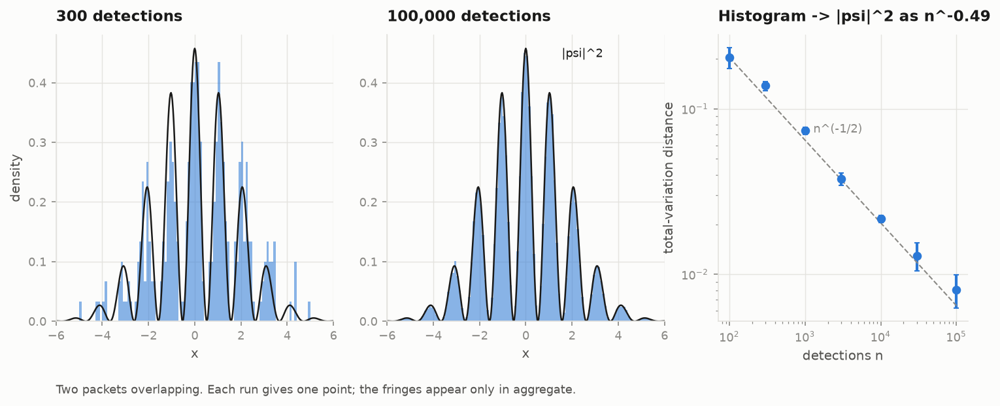
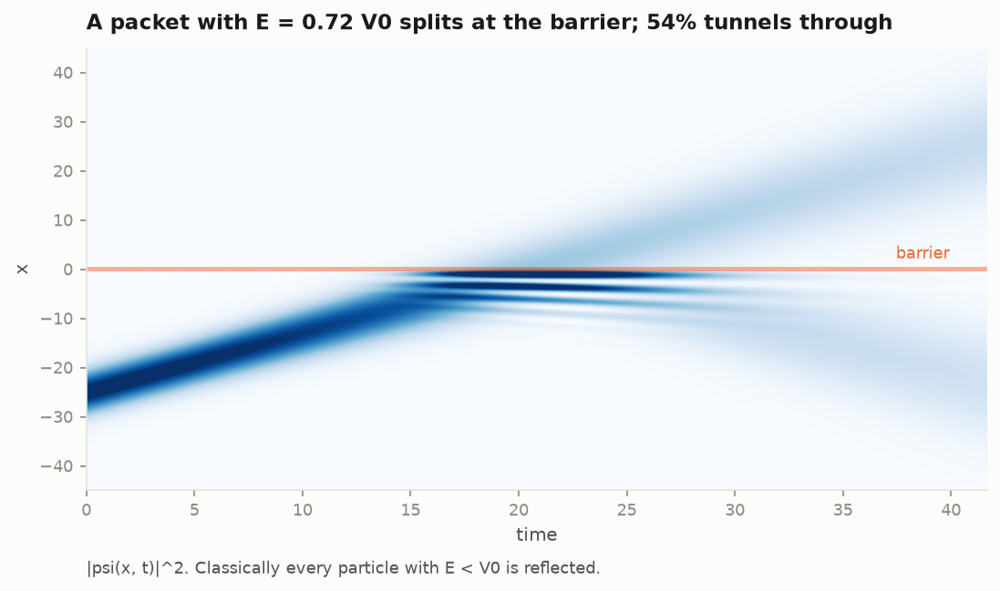
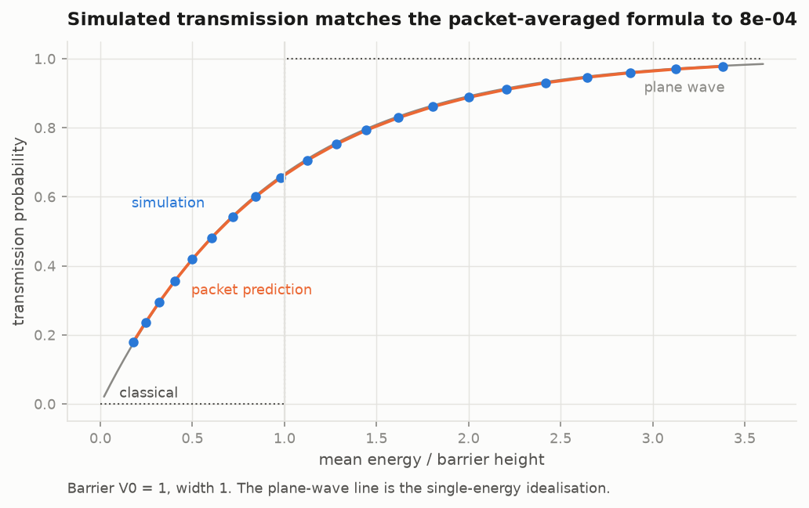
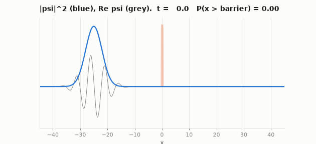
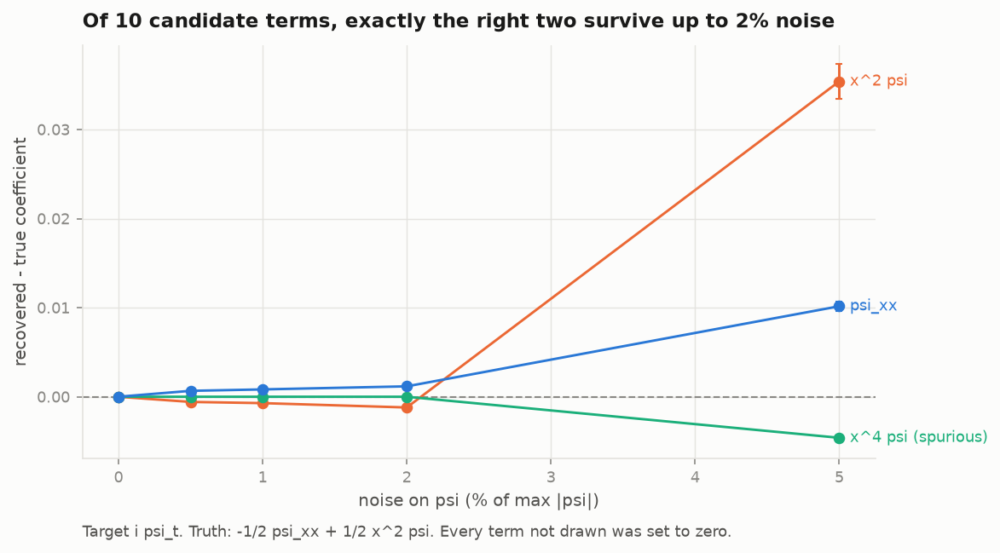

# schrodinger: the equation, built, solved, tested and rediscovered

The other two sub-projects use the quantum formalism as a modelling language
for data that is not quantum. This one is about the equation itself: where
it comes from, what it predicts about where a particle is found, how to
solve it on a computer without fooling yourself, and whether it can be read
back out of data by a machine that is not told what it is.

Code: [`src/qphys/schrodinger`](../../src/qphys/schrodinger) ·
Tables: [`results/`](../../results) ·
Tutorial: [`tutorial/`](tutorial/)

```
qphys run schrodinger          # every table below, about two minutes with PySR
python -m qphys.schrodinger.figures
```

Units are hbar = m = 1 throughout, so the equation is

$$ i\,\partial_t \psi = -\tfrac12\,\partial_x^2 \psi + V(x)\,\psi . $$

---

## The tutorial

| Part | Question | Figures |
|---|---|---|
| [1 · From waves to the equation](tutorial/01_from_waves_to_the_equation.md) | Why this equation, and why is it complex? | |
| [2 · What psi predicts](tutorial/02_what_psi_predicts.md) | If psi is not the position, what does it say about the position? | 11 |
| [3 · Stationary states](tutorial/03_stationary_states.md) | Where do quantised energies come from, and how is that computed? | 08, 14 |
| [4 · Time evolution](tutorial/04_time_evolution.md) | How do you integrate it without breaking probability? | |
| [5 · Tunnelling](tutorial/05_tunneling.md) | What happens at a wall the particle cannot classically climb? | 09, 10, 12 |
| [6 · Rediscovering the equation](tutorial/06_rediscovering_the_equation.md) | Can sparse and symbolic regression find it from psi(x, t) alone? | 13 |

Each part states the mathematics, then the code that implements it, then
the measured check that the code is right.

---

## Stationary states


Bound states exist only at discrete energies because psi must vanish at
both ends; most energies give a solution that blows up. The harmonic levels
are equally spaced at n + 1/2, and the solver reproduces them to a relative
error of 1.3e-7 over the first eight. In a double well every level of a
single well splits into an even and an odd combination. The splitting is the
tunnelling rate between the wells, and it shrinks exponentially with the
barrier.

## What psi predicts about position



A wavefunction does not say where the particle is. It gives the probability
density |psi|^2 for where a detector will find it. One run gives one point.
The fringes of two overlapping packets are invisible at 300 detections and
sharp at 100,000. The total-variation distance between the histogram and
|psi|^2 falls as n^-0.485, close to the n^-1/2 of independent sampling.

## Tunnelling





A packet with mean energy below the barrier is partly transmitted. Over 21
energies from 0.18 V0 to 3.38 V0, the simulated transmission agrees with the
plane-wave formula averaged over the packet's momentum distribution to
8.0e-4. Against the unaveraged single-energy formula the gap is up to 4.0e-3,
which is the size of the effect of the packet's momentum spread. Getting to
8.0e-4 required one correction, described in part 5: sampling the barrier
pointwise made it 1.6% too wide and cut transmission by up to 3.0%.



## Reading the equation back from data



Given only snapshots of psi(x, t) in a harmonic well, sparse regression over
ten candidate terms keeps exactly two, -1/2 psi_xx and 1/2 x^2 psi, at every
noise level up to 2% of max |psi| and on all five seeds. At 2% the recovered
coefficients are -0.4988 and 0.4988. At 5% a spurious x^4 psi term with
coefficient -0.0046 enters and the x^2 coefficient is biased to 0.535.

Symbolic regression with PySR, given numerical solutions and no formula:

| Task | Input | PySR found | Truth |
|---|---|---|---|
| infinite well | E(n, L) | `4.9348*n**2/L**2` | pi^2/2 = 4.9348 |
| quartic well | E_n, n = 2..39 | `n**0.3321*(1.38266334*n + 0.919038)` | WKB: 1.3765 (n + 1/2)^(4/3) |
| potential | ground-state density only | `x**2*(0.2499*x**2 - 0.9998) + 0.2994` | x^4/4 - x^2, plus -E0 = 0.2995 |

The quartic expression is not the WKB form. Its large-n behaviour is
1.3827 n^1.3321, against WKB's 1.3765 n^1.3333. The regressor found the
exponent and the prefactor to 0.1% and 0.5%, inside an expression that a
physicist would not have written. Part 6 discusses what that does and does
not show.

## Numerics that were checked rather than trusted


The finite-difference eigenvalues converge as dx^1.9993 with the three-point
stencil and dx^3.9983 with the five-point one. The five-point result needed
the correct boundary row (part 3); with the naive one it converged only as
dx^1. The split-operator integrator conserves the norm to 1.1e-13 at every
step size, and its error after one oscillator period falls from 0.070 at
dt = 0.2 to 1.75e-4 at dt = 0.01, the dt^2 of Strang splitting.

| Check | Result | Table |
|---|---|---|
| harmonic levels, n = 0..7 | max relative error 1.3e-7 | `schrodinger_spectrum.csv` |
| infinite-well levels, n = 1..8 | max relative error 1.7e-7 | `schrodinger_spectrum.csv` |
| stencil order, 3- and 5-point | 1.9993, 3.9983 | `schrodinger_convergence.csv` |
| norm drift, any dt | at most 1.1e-13 | `schrodinger_conservation.csv` |
| Ehrenfest residual, dt = 0.01 | 2.5e-5 | `schrodinger_conservation.csv` |
| Born-rule convergence exponent | -0.485 | `schrodinger_born.csv` |
| tunnelling vs packet formula | 8.0e-4 | `schrodinger_tunneling.csv` |
| exact equation recovered | up to 2% noise, 5/5 seeds | `schrodinger_discovery.csv` |
