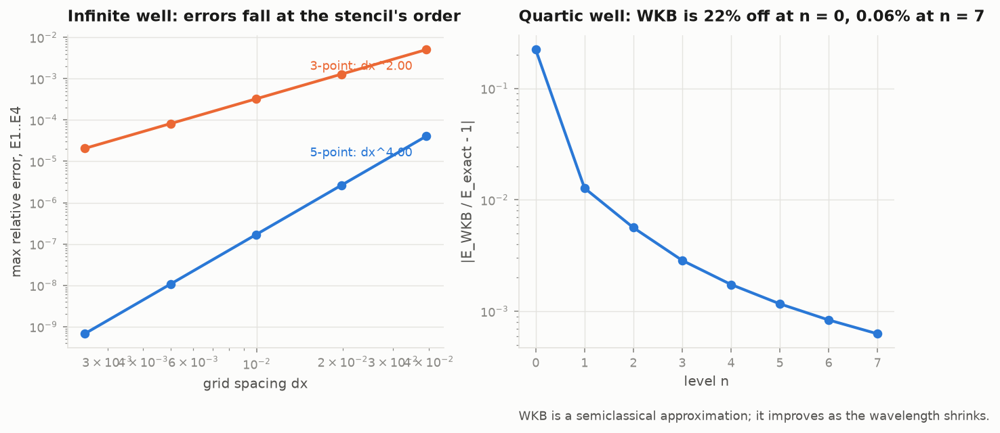
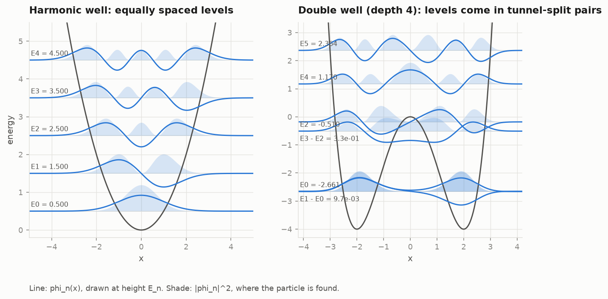

# 3 · Stationary states

[Previous](02_what_psi_predicts.md) · [Topic page](../README.md) · Next: [4 · Time evolution](04_time_evolution.md)

## Separation of variables

Try a solution of the form psi(x, t) = phi(x) exp(-i E t). Substituting
into the equation removes the time dependence and leaves

$$ \Big[-\tfrac12\,\partial_x^2 + V(x)\Big]\phi = E\,\phi . $$

This is an eigenvalue problem. The density |psi|^2 = |phi|^2 does not change
in time, hence "stationary". Because the equation is linear, any state is a
sum of these with time-dependent phases:

$$ \psi(x, t) = \sum_n c_n\,e^{-iE_n t}\,\phi_n(x), \qquad c_n = \langle \phi_n | \psi(0)\rangle . $$

Part 4 uses this sum as the exact reference for the time integrator.

## Why energies are quantised

For most values of E, integrating the equation outward from the bottom of a
well gives a phi that grows without bound at large |x|. Such a phi cannot be
normalised and is not a state. Only at special values of E does the growing
part vanish on both sides. Those values are the energy levels.

On a grid the same thing happens in matrix form: the Hamiltonian is an N x N
symmetric matrix with N real eigenvalues, and the low ones converge to the
bound-state energies as the grid is refined.

## The discrete Hamiltonian

The second derivative at grid point j is approximated by a stencil:

$$ \psi''_j \approx \frac{\psi_{j-1} - 2\psi_j + \psi_{j+1}}{dx^2} \quad (\text{3-point}, O(dx^2)) $$

$$ \psi''_j \approx \frac{-\psi_{j-2} + 16\psi_{j-1} - 30\psi_j + 16\psi_{j+1} - \psi_{j+2}}{12\,dx^2} \quad (\text{5-point}, O(dx^4)) $$

`grid.laplacian(grid, order)` builds either; `stationary.eigenstates`
solves for the lowest k states with a sparse shift-invert eigensolver.

### The boundary row

The 5-point stencil reaches two points beyond each end of the grid. For a
particle in a box with walls at 0 and L, the wavefunction is zero on the
wall one step out, and the natural continuation two steps out is the odd
reflection, -psi_0. Leaving that point at zero instead makes the first and
last rows of the matrix wrong at O(1), and the eigenvalues then converge
only as dx^1. With the correct row the diagonal entry at each end is -29/12
instead of -30/12.



Measured on the infinite well (left panel), the errors converge as
dx^1.9993 and dx^3.9983. For the harmonic well with 1000 points on
[-10, 10], the first eight levels match n + 1/2 to a relative error of
1.3e-7.

## Three potentials



- **Harmonic, V = x^2/2.** E_n = n + 1/2, exactly equally spaced.
  phi_n is a Hermite polynomial times a Gaussian; `harmonic_state` gives it.
- **Infinite well of width L.** E_n = pi^2 n^2 / (2 L^2). Part 6 asks PySR
  to find this formula from numerical eigenvalues alone.
- **Double well, V = x^4/4 - a x^2.** No closed form. With depth 4 (a = 2),
  the two lowest states are the even and odd combinations of a state
  localised in each well, split by 9.7e-3. A particle started in one well
  oscillates between the wells with period 2 pi / 9.7e-3, about 650 time
  units. That is tunnelling in a bound system.

## When there is no closed form: WKB

For V = x^4 the Bohr-Sommerfeld condition, the integral of p dx around a
classical orbit equal to 2 pi (n + 1/2), gives

$$ E_n \approx \Big[\frac{\pi\,(n + \tfrac12)}{\sqrt2\,I}\Big]^{4/3}, \qquad I = \int_{-1}^{1}\sqrt{1-u^4}\,du . $$

The right panel above compares it with the numerics. It is 22% off for the
ground state and 0.063% off at n = 7. WKB is a short-wavelength
approximation and improves as n grows. The exponent 4/3 comes from the
scaling of the action with E and is what part 6 asks a symbolic regressor
to find.

```python
import numpy as np
from qphys.schrodinger import grid as G, stationary as S

g = G.Grid(-12, 12, 3000)
E, phi = S.eigenstates(g, G.quartic(g.x), k=8)
E / S.quartic_wkb_energy(np.arange(8)) - 1
```
